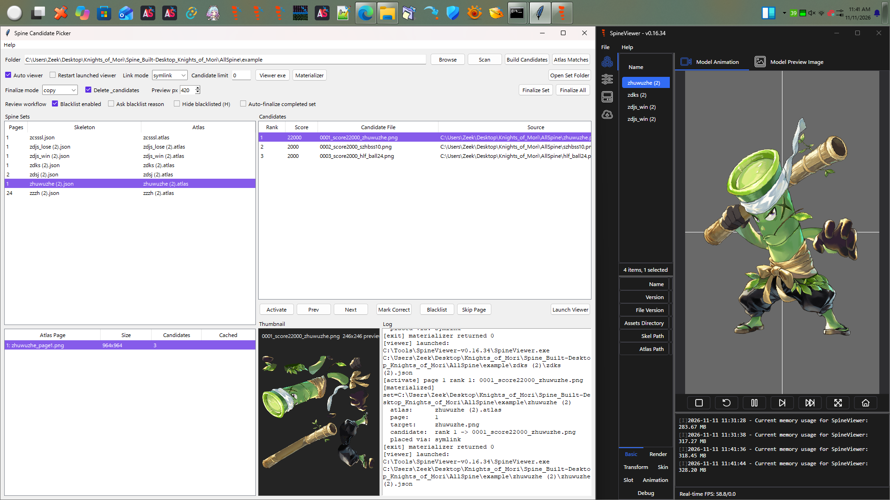
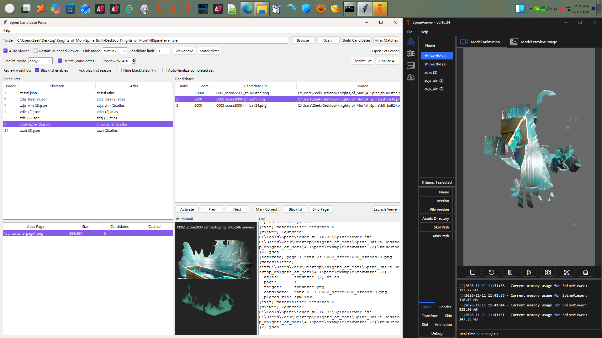

# Spine Magic Builder: ready-to-post drafts

The two screenshots below show the same set with different candidates activated. When posting to a forum, attach the images from `docs/` if the site does not display Markdown images from GitHub.

## English

**Title:** I made a little tool for rebuilding scattered Spine assets (Spine Magic Builder)

Hey! I’ve been working on a Windows tool called **Spine Magic Builder** and thought some people here might find it useful. It’s for those extracted asset folders where the Spine skeleton, atlas, and textures are scattered around or named in ways that don’t help much.

Point it at a folder and it searches for Spine data and possible atlas/texture matches, then builds sets you can inspect. When there are several textures with the same dimensions, the candidate picker lets you try them one by one. You can use Left/Right to step through candidates, check the result in SpineViewer, mark the right one, and finalize the set. It keeps the original source files in place during the normal build workflow.

There’s a single Windows exe now: download **SpineMagicBuilder.exe**, double-click it, choose a folder, and hit **Build Candidates**. No Python setup needed. For visual checking you’ll need to get **SpineViewer** separately and point the picker to it once; I don’t bundle anyone else’s viewer or assets.

I made this because I kept doing the same detective work by hand. It’s still a tool for checking possibilities, not a promise that every extracted set will assemble perfectly. If you try it, I’d love to hear which formats or workflows give it trouble.

**Download:** https://github.com/Randombirdnoise/Spine_Magic_Builder/releases/latest

**Source:** https://github.com/Randombirdnoise/Spine_Magic_Builder

**Candidate 1:**

**Candidate 2:**

## 简体中文

**标题：** 我做了一个整理零散 Spine 资源的小工具：Spine Magic Builder

大家好！最近我做了一个 Windows 小工具，叫 **Spine Magic Builder**。如果你也遇到过那种骨骼、atlas 和贴图散落在不同目录里，文件名又很难看懂的资源包，或许会用得上。

选中资源文件夹后，它会查找 Spine 数据，尝试匹配 atlas 和贴图，并生成方便检查的组合。如果有多张尺寸相同、暂时无法确定的贴图，可以在候选选择器里逐张试。按左右方向键切换候选，在 SpineViewer 里看效果，找到合适的就标记并整理成最终文件夹。正常构建流程会保留原始资源。

现在也有单文件 Windows exe：下载 **SpineMagicBuilder.exe**，双击打开，选择文件夹，再点 **Build Candidates**，不用装 Python。目视检查需要另行下载 **SpineViewer**，第一次在工具里指定它的 exe 即可；我没有把别人的查看器或游戏资源打包进去。

我做这个主要是因为自己反复手工找这些文件，实在太费劲。它能帮忙缩小范围，但不保证所有资源都能自动拼对。如果你试用了，欢迎告诉我哪些格式或流程还有问题。

**下载：** https://github.com/Randombirdnoise/Spine_Magic_Builder/releases/latest

**源码：** https://github.com/Randombirdnoise/Spine_Magic_Builder

**候选图 1：**

**候选图 2：**

